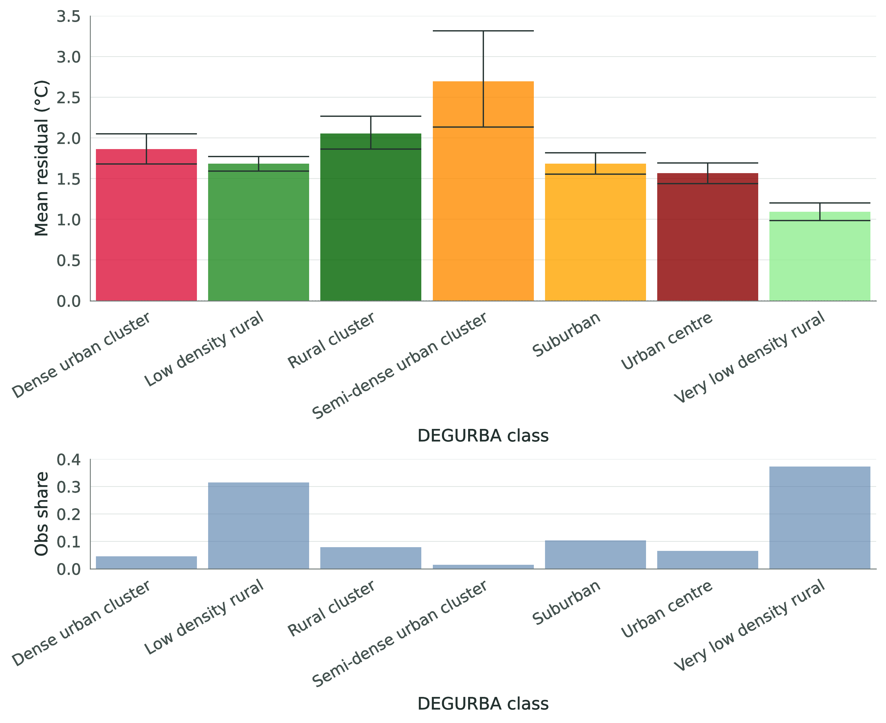
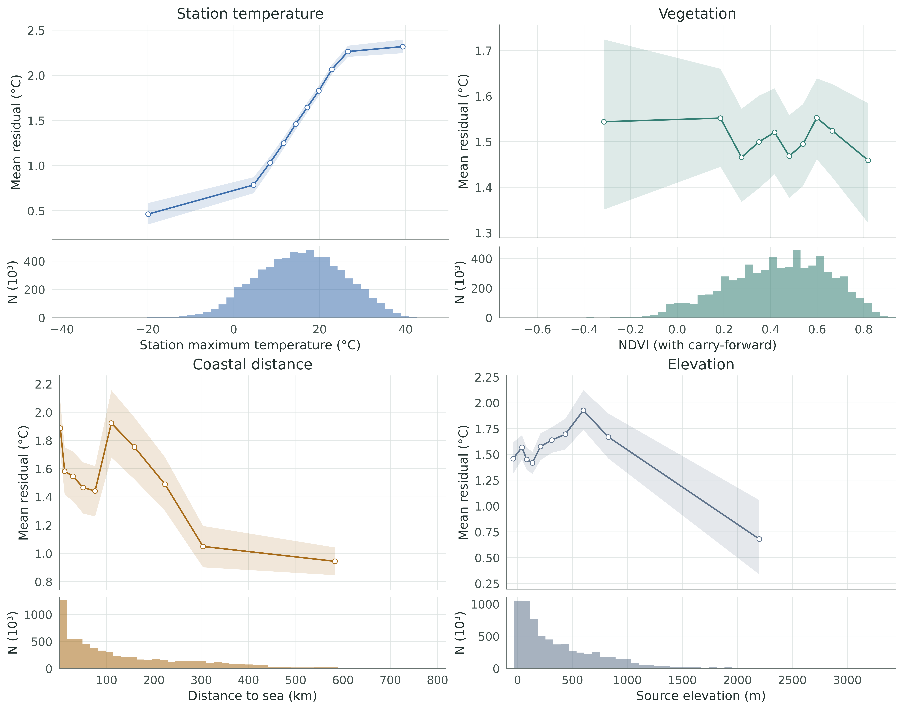
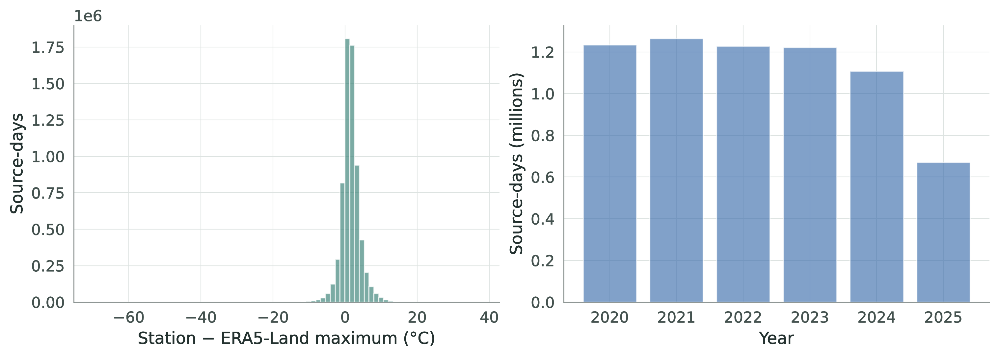
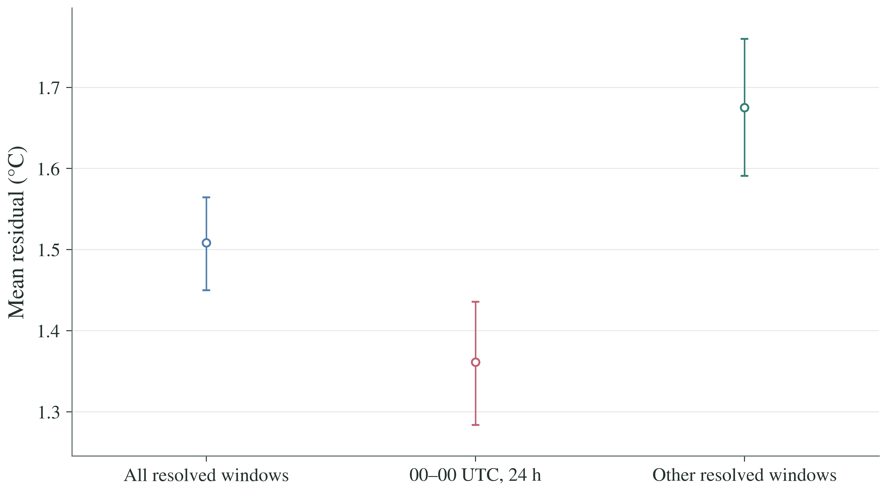
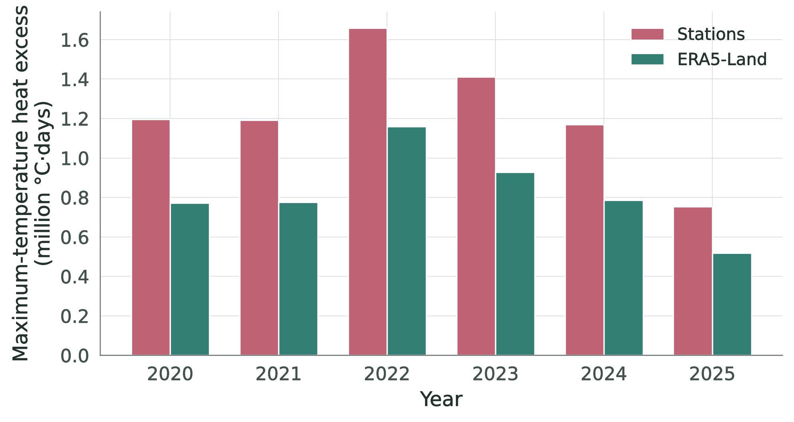
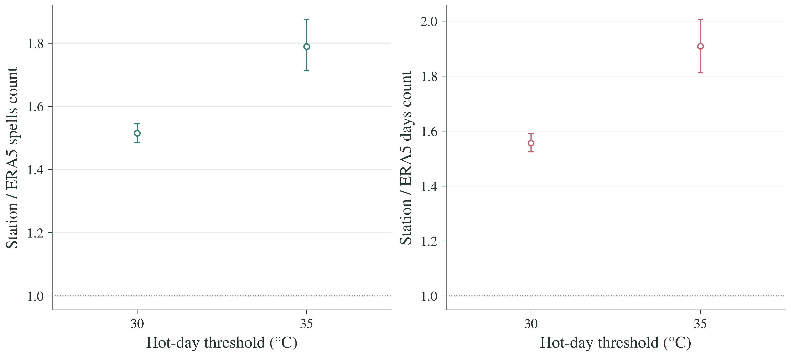
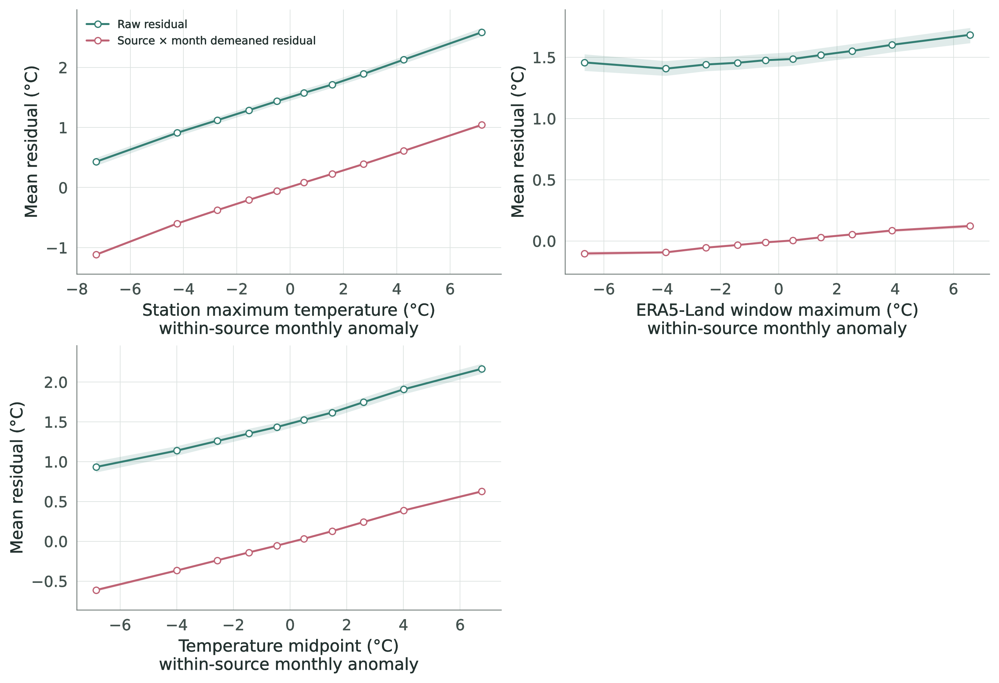
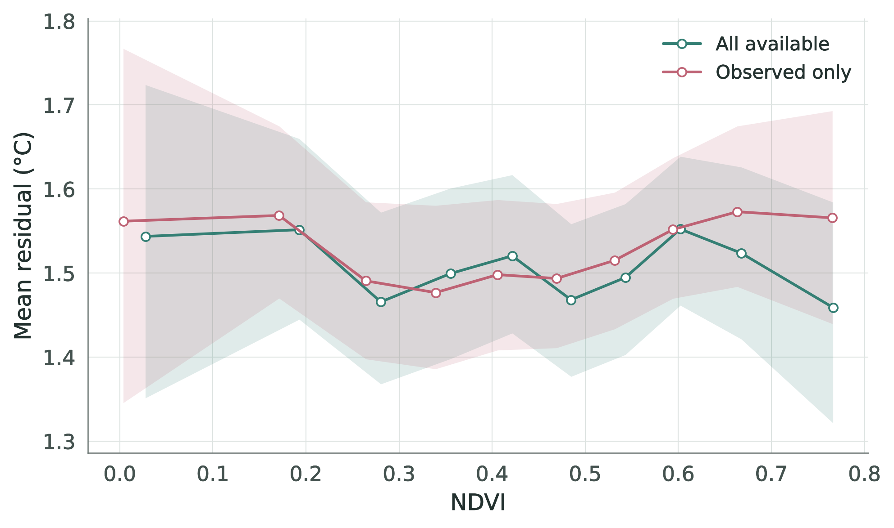
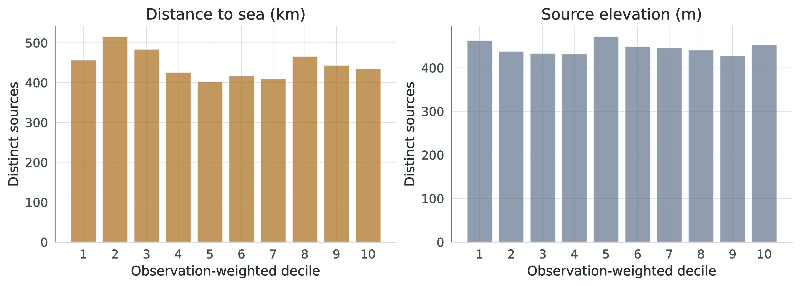
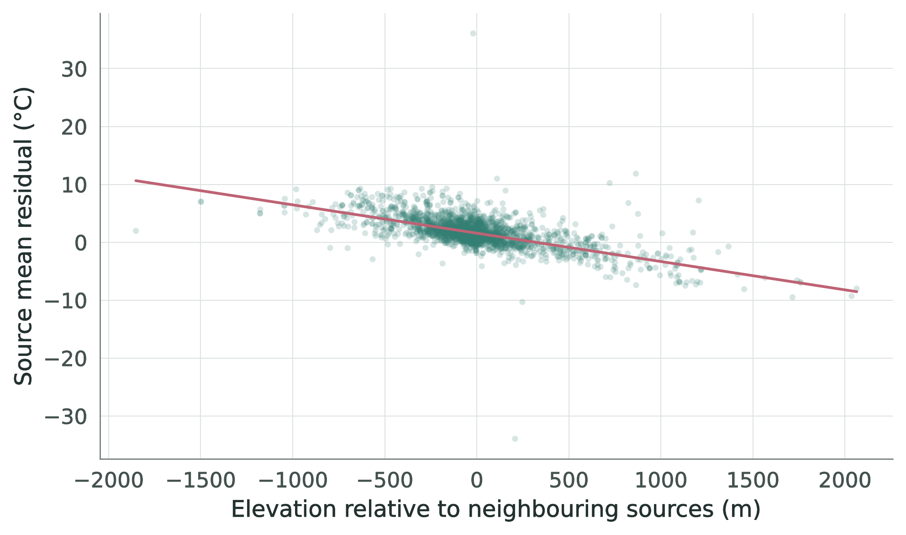

# Numerical analysis

## 1. DEGURBA partial dependence



Upper panel: mean **station maximum − ERA5-Land maximum**, with pointwise 95% source-bootstrap intervals. Lower panel: share of all retained source-days. [PDF](assets/degurba.pdf) · [Source table](assets/degurba.csv).

The current sample contains **6,726,213 source-days**. The seven land classes contain **6,692,879 observations**; **33,334 water-class observations** are omitted. Shares retain the full-sample denominator. The 2020 GHS-SMOD classification is sampled at actual source coordinates and held fixed over time.

| Class | Mean (°C) | 95% low | 95% high | Source-days | Sources | Sample (%) |
| :--- | :--- | :--- | :--- | :--- | :--- | :--- |
| Dense urban cluster | 1.86 | 1.68 | 2.05 | 308,267 | 236 | 4.58 |
| Low density rural | 1.68 | 1.59 | 1.77 | 2,121,975 | 1,335 | 31.55 |
| Rural cluster | 2.06 | 1.86 | 2.27 | 528,777 | 349 | 7.86 |
| Semi-dense urban cluster | 2.70 | 2.13 | 3.31 | 97,265 | 70 | 1.45 |
| Suburban | 1.68 | 1.55 | 1.82 | 694,661 | 450 | 10.33 |
| Urban centre | 1.57 | 1.44 | 1.69 | 434,842 | 302 | 6.46 |
| Very low density rural | 1.09 | 0.98 | 1.20 | 2,507,092 | 1,697 | 37.27 |

These are unadjusted, observation-weighted class means. Intervals use 1,000 draws of SOUIDs within each class, retaining each source's days together; seed 1337. The figure preserves the paper's layout, colours and displayed class order, with Seaborn styling and light horizontal grids. Class differences do not isolate an urbanisation effect.

[Coverage](assets/degurba_coverage.csv) · [Source classifications](assets/degurba_sources.csv) · [Manifest](assets/degurba_manifest.json)

Class means range from **+1.09°C** (Very low density rural) to **+2.70°C** (Semi-dense urban cluster, **70 sources**).

## 2. Sample and interpretation

Study period: **1 January 2020–31 August 2025**. One source-day is one `(SOUID, DATE)`. All temperatures use resolved provider UTC windows and complete hourly ERA5 coverage, including both boundary samples. Resolved 12-hour and 23/25-hour windows remain included. Wind and rain use those same windows. The pipeline retains the temperature sample and selects available covariates per analysis.

NDVI uses the original seasonal rasters; dates without a raster carry forward the latest earlier valid location value across seasons. Source dates and extrapolation flags remain available. The separate NDVI acquisition archive is not used.

The additional analyses below are reruns of the ZIP's `pending_remarks_analysis.py` and `supplemental_v3_checks.py`. They use the current sample, rather than the earlier 6.96-million-row release. Bootstrap and clustered inference use actual observation sources (`SOUID`), replacing nominal blended station IDs. Unless stated otherwise, bootstrap intervals use 1,000 draws and seed 1337. They address within-source dependence, not dependence between nearby sources.

## 3. Descriptive residual profiles



Observation-weighted means in ten quantile bins, with pointwise source-bootstrap intervals. These are descriptive conditional means. Station temperature also enters the residual definition. Each vertical range follows its mean curve and confidence band.

[Profile tables](../figures/notebooks/partial_dependence/tables/) · [Manifest](../figures/notebooks/partial_dependence/manifest.json)

**Hourly weather pending:** the current composite contains the four available profiles. All six are queued after hourly aggregation.

## 4. Cross-interaction profiles


Eight quantile bins per numeric axis; seven land DEGURBA classes. Cells show observation-weighted mean residuals, with all available observations in the marginal histograms. Each panel has its own colour scale. No cell confidence intervals are shown.

**Hourly wind pending:** the current composite contains elevation × coast and coast × DEGURBA. The two wind panels are queued.

## 5. Sample and variable coverage

Every retained source-day enters the parent sample. Units: temperature °C, wind m/s, precipitation m per window, elevation m, coastal distance km; NDVI is unitless. Covariate availability is reported separately. The study ends in August 2025, so yearly counts have unequal time coverage.

**Partial rerun:** temperature and static-covariate results are current; hourly-weather results are pending.



| Variable | Source-days | Missing | Mean | SD |
| :--- | :--- | :--- | :--- | :--- |
| station_celsius | 6,726,213 | 0 | 15.592 | 10.028 |
| era5_celsius | 6,726,213 | 0 | 14.083 | 9.743 |
| residual_celsius | 6,726,213 | 0 | 1.508 | 2.511 |
| ndvi | 6,715,480 | 10,733 | 0.430 | 0.219 |
| elevation | 6,722,390 | 3,823 | 402.154 | 440.430 |
| dist_to_sea_km | 6,726,213 | 0 | 139.492 | 139.458 |

Mean disagreement: **+1.51°C**, 95% source-bootstrap interval **1.45–1.56°C**. Giving every source equal weight gives **+1.49°C**.

[PDF](../figures/notebooks/numerical_analysis/descriptive/sample.pdf) · [Tables](../figures/notebooks/numerical_analysis/descriptive/tables/) · [Methods and results](../figures/notebooks/numerical_analysis/descriptive/results.json) · [Input manifest](../figures/notebooks/numerical_analysis/descriptive/manifest.json)

## 6. Observation-window sensitivity

Compare 24-hour 00–00 UTC windows with other resolved windows. Both groups already have window-matched ERA5 maxima; their difference reflects sample composition rather than the former date-only matching. The companion profiles recalculate deciles within each sample.

**Partial rerun:** temperature and static-covariate results are current; hourly-weather results are pending.



| Sample | Source-days | Sources | Mean | 95% low | 95% high |
| :--- | :--- | :--- | :--- | :--- | :--- |
| full | 6,726,213 | 4,458 | 1.508 | 1.450 | 1.564 |
| utc_midnight | 3,576,314 | 2,184 | 1.361 | 1.284 | 1.436 |
| other_resolved | 3,149,899 | 2,274 | 1.675 | 1.591 | 1.760 |

[PDF](../figures/notebooks/numerical_analysis/utc_windows/window_means.pdf) · [Tables](../figures/notebooks/numerical_analysis/utc_windows/tables/) · [Methods and results](../figures/notebooks/numerical_analysis/utc_windows/results.json) · [Input manifest](../figures/notebooks/numerical_analysis/utc_windows/manifest.json)

## 7. Hot-day exceedances

Count strict exceedances of 25, 30, 35 and 40°C. The displayed table uses the full sample; source tables also cover semi-dense urban, broader urban, low-wind and UTC subsets. Count ratios are distinct from detection recall or precision. Sparse-event intervals can be unbounded; flags are retained in the CSV.

**Pending rerun.** Weather-dependent sections run automatically after hourly aggregation.

## 8. Daily-maximum heat excess above 24°C

Sum max(Tmax − 24°C, 0). This is a daily-maximum heat-excess proxy, not cooling degree-days based on daily mean temperature. The station/ERA5 ratio uses a source-bootstrap interval.



| Station heat excess (°C·days) | ERA5 heat excess (°C·days) | Station / ERA5 | 95% low | 95% high |
| :--- | :--- | :--- | :--- | :--- |
| 7,380,645.400 | 4,936,754.347 | 1.495 | 1.474 | 1.517 |

The station heat-excess total is **1.50 times** the ERA5-Land total over the same retained source-days.

[PDF](../figures/notebooks/numerical_analysis/heat_excess/heat_excess_by_year.pdf) · [Tables](../figures/notebooks/numerical_analysis/heat_excess/tables/) · [Methods and results](../figures/notebooks/numerical_analysis/heat_excess/results.json) · [Input manifest](../figures/notebooks/numerical_analysis/heat_excess/manifest.json)

## 9. Hot spells of at least three days

Count runs of at least three consecutive date-labelled maxima above 30 or 35°C. Gaps break runs. Ratios retain zero-event sources in the bootstrap; the result is conditional on retained observation coverage.



| Threshold (°C) | Counted | Station | ERA5 | Station / ERA5 | 95% low | 95% high |
| :--- | :--- | :--- | :--- | :--- | :--- | :--- |
| 30 | spells | 50,616 | 33,405 | 1.515 | 1.486 | 1.545 |
| 30 | days | 419,885 | 269,769 | 1.556 | 1.525 | 1.592 |
| 35 | spells | 14,440 | 8,068 | 1.790 | 1.713 | 1.875 |
| 35 | days | 88,035 | 46,122 | 1.909 | 1.812 | 2.006 |

[PDF](../figures/notebooks/numerical_analysis/heatwaves/heatwave_ratios.pdf) · [Tables](../figures/notebooks/numerical_analysis/heatwaves/tables/) · [Methods and results](../figures/notebooks/numerical_analysis/heatwaves/results.json) · [Input manifest](../figures/notebooks/numerical_analysis/heatwaves/manifest.json)

## 10. Seasonal temperature × wind

Recalculate 10 × 10 temperature/wind bins within DJF, MAM, JJA and SON. Each curve shows the warmest temperature decile across that season's wind bins. Compare conditioning on station temperature and on ERA5 temperature. Mean-vector wind does not measure wind at the temperature maximum.

**Pending rerun.** Weather-dependent sections run automatically after hourly aggregation.

## 11. Within-source monthly anomalies

Demean each variable and the residual by SOUID × calendar month, pooling years. Station temperature, ERA5 temperature and their midpoint provide different coupling diagnostics. Demeaning removes source-month means; it does not identify causal effects.

**Partial rerun:** temperature and static-covariate results are current; hourly-weather results are pending.



| Conditioning anomaly | Lowest-bin residual | Highest-bin residual | High − low (°C) |
| :--- | :--- | :--- | :--- |
| station_celsius | -1.117 | 1.044 | 2.161 |
| era5_celsius | -0.102 | 0.122 | 0.224 |
| midpoint | -0.613 | 0.627 | 1.240 |

[PDF](../figures/notebooks/numerical_analysis/fixed_effects/within_source_month.pdf) · [Tables](../figures/notebooks/numerical_analysis/fixed_effects/tables/) · [Methods and results](../figures/notebooks/numerical_analysis/fixed_effects/results.json) · [Input manifest](../figures/notebooks/numerical_analysis/fixed_effects/manifest.json)

## 12. Joint adjusted regression

Complete-case OLS uses standardized midpoint, wind, distance, elevation, log precipitation and NDVI; midpoint × wind; an urban indicator (22/23/30); and month indicators. Intervals use source-clustered CR1 covariance. The midpoint includes station temperature, so this is descriptive adjustment rather than a feasible correction model.

**Pending rerun.** Weather-dependent sections run automatically after hourly aggregation.

## 13. Formal tests of the descriptive profiles

Test equality of residual means across each feature's ten quantile bins with a source-clustered Wald F test. Report effect ranges alongside unadjusted p-values; a small p-value does not establish practical importance or causality.

**Pending rerun.** Weather-dependent sections run automatically after hourly aggregation.

## 14. Observed-season NDVI sensitivity

Compare all available original-season/carry-forward NDVI with observed seasonal values only. Each sample has its own deciles. Date coverage and station composition also change, so the difference does not isolate extrapolation error.



| Sample | Source-days | Sources | Bin range (°C) | Wald F | p |
| :--- | :--- | :--- | :--- | :--- | :--- |
| all_available | 6,715,480 | 4,456 | 0.093 | 0.617 | 0.783 |
| observed_only | 4,845,070 | 4,220 | 0.096 | 0.556 | 0.834 |

Observed-only decile means span **0.096°C**; the source-clustered equality test gives **p = 0.834**.

[PDF](../figures/notebooks/numerical_analysis/ndvi_sensitivity/observed_vs_carry_forward.pdf) · [Tables](../figures/notebooks/numerical_analysis/ndvi_sensitivity/tables/) · [Methods and results](../figures/notebooks/numerical_analysis/ndvi_sensitivity/results.json) · [Input manifest](../figures/notebooks/numerical_analysis/ndvi_sensitivity/manifest.json)

## 15. Geographic bin coverage

Observation-weighted deciles can contain very different numbers of sources. The saved tables report actual bounds, source-days, distinct sources, residual means and intervals for every elevation and coastal-distance bin.



| Decile | Bin low | Bin high | Source-days | Sources | Mean |
| :--- | :--- | :--- | :--- | :--- | :--- |
| 1 | 0.007 | 4.022 | 674,431 | 457 | 1.887 |
| 2 | 4.044 | 18.462 | 671,205 | 516 | 1.582 |
| 3 | 18.484 | 39.250 | 673,803 | 484 | 1.545 |
| 4 | 39.320 | 61.159 | 672,143 | 426 | 1.467 |
| 5 | 61.191 | 89.951 | 672,621 | 403 | 1.442 |
| 6 | 90.104 | 130.068 | 672,125 | 417 | 1.923 |
| 7 | 130.327 | 187.295 | 673,156 | 410 | 1.754 |
| 8 | 187.347 | 259.525 | 673,090 | 466 | 1.490 |
| 9 | 259.732 | 348.313 | 671,633 | 444 | 1.049 |
| 10 | 348.757 | 817.510 | 672,006 | 435 | 0.943 |

| Decile | Bin low | Bin high | Source-days | Sources | Mean |
| :--- | :--- | :--- | :--- | :--- | :--- |
| 1 | -100.000 | 20.000 | 697,321 | 463 | 1.459 |
| 2 | 21.000 | 60.000 | 667,422 | 438 | 1.568 |
| 3 | 61.000 | 107.000 | 662,659 | 433 | 1.451 |
| 4 | 108.000 | 164.000 | 661,619 | 432 | 1.418 |
| 5 | 165.000 | 253.000 | 672,336 | 472 | 1.576 |
| 6 | 254.000 | 368.000 | 674,959 | 449 | 1.638 |
| 7 | 370.000 | 502.000 | 674,424 | 446 | 1.696 |
| 8 | 503.000 | 695.000 | 669,762 | 441 | 1.927 |
| 9 | 696.000 | 958.000 | 672,639 | 428 | 1.668 |
| 10 | 959.000 | 3,440.000 | 669,249 | 453 | 0.680 |

[PDF](../figures/notebooks/numerical_analysis/geographic_deciles/sources_per_decile.pdf) · [Tables](../figures/notebooks/numerical_analysis/geographic_deciles/tables/) · [Methods and results](../figures/notebooks/numerical_analysis/geographic_deciles/results.json) · [Input manifest](../figures/notebooks/numerical_analysis/geographic_deciles/manifest.json)

## 16. Neighbour-source relative elevation

Subtract the mean elevation of at least two distinct source locations 0.1–25 km away. This is a network-based proxy, not a DEM-derived topographic position or a station/grid elevation difference. The naive Pearson p-value does not account for spatial dependence.



| Elevation band | Sources | Relative height (m) | Below neighbours (%) | Mean source residual (°C) |
| :--- | :--- | :--- | :--- | :--- |
| 105–500m | 1,109 | -59.750 | 64.923 | 1.738 |
| <=105m | 718 | -96.105 | 82.033 | 1.699 |
| 695–958m | 317 | 14.036 | 44.164 | 1.685 |
| >958m | 398 | 330.419 | 28.894 | 0.550 |
| 500–695m | 335 | -63.122 | 52.537 | 2.118 |

Proxy available at **2,877 sources**. Source-level Pearson r = **-0.625**; descriptive slope = **-0.490°C per 100 m**.

[PDF](../figures/notebooks/numerical_analysis/relative_elevation/neighbour_elevation_residual.pdf) · [Tables](../figures/notebooks/numerical_analysis/relative_elevation/tables/) · [Methods and results](../figures/notebooks/numerical_analysis/relative_elevation/results.json) · [Input manifest](../figures/notebooks/numerical_analysis/relative_elevation/manifest.json)

## 17. Held-out-source bias correction

Five GroupKFold splits hold out SOUIDs, with no source overlap. Compare raw ERA5, a training-mean offset, spline/ridge, boosted trees, and trees with relative elevation. Learned models use the same sampled training rows, capped at 800,000 per fold. Predictors exclude station temperature and midpoint. These source holdouts are not spatial or future-year holdouts.

**Pending rerun.** Weather-dependent sections run automatically after hourly aggregation.

## 18. Fitted-model partial dependence

Replace one predictor at a time and average predictions on held-out background rows. Combine all five fold models, using 5th–95th percentile grids. Shading and categorical whiskers show the fold range, not a confidence interval. The fitted categorical panel includes the water code retained in the correction-model input. These fitted-model profiles differ from the unadjusted residual profiles at the start of this note and need not represent feasible or causal interventions.

**Pending rerun.** Weather-dependent sections run automatically after hourly aggregation.

## Reproduction

| Analysis | File | Status |
| :--- | :--- | :--- |
| Sample and variable coverage | [analysis_descriptive.py](../src/py/analysis_descriptive.py) | Weather portion pending |
| Observation-window sensitivity | [analysis_utc_windows.py](../src/py/analysis_utc_windows.py) | Weather portion pending |
| Hot-day exceedances | [analysis_exceedances.py](../src/py/analysis_exceedances.py) | Pending |
| Daily-maximum heat excess above 24°C | [analysis_heat_excess.py](../src/py/analysis_heat_excess.py) | Complete |
| Hot spells of at least three days | [analysis_heatwaves.py](../src/py/analysis_heatwaves.py) | Complete |
| Seasonal temperature × wind | [analysis_seasonal.py](../src/py/analysis_seasonal.py) | Pending |
| Within-source monthly anomalies | [analysis_fixed_effects.py](../src/py/analysis_fixed_effects.py) | Weather portion pending |
| Joint adjusted regression | [analysis_multivariate.py](../src/py/analysis_multivariate.py) | Pending |
| Formal tests of the descriptive profiles | [analysis_covariate_tests.py](../src/py/analysis_covariate_tests.py) | Pending |
| Observed-season NDVI sensitivity | [analysis_ndvi_sensitivity.py](../src/py/analysis_ndvi_sensitivity.py) | Complete |
| Geographic bin coverage | [analysis_geographic_deciles.py](../src/py/analysis_geographic_deciles.py) | Complete |
| Neighbour-source relative elevation | [analysis_relative_elevation.py](../src/py/analysis_relative_elevation.py) | Complete |
| Held-out-source bias correction | [analysis_mos.py](../src/py/analysis_mos.py) | Pending |
| Fitted-model partial dependence | [analysis_model_partial_dependence.py](../src/py/analysis_model_partial_dependence.py) | Pending |

Run all sections in a dedicated tmux session:

```bash
bash src/py/scripts/run_numerical_analysis.sh
```

Run one analysis with `uv run python -m py.analysis_<name>` in its own tmux session. The full runner refreshes DEGURBA, all six descriptive profiles, four interaction plots, the additional analyses, manuscript tables and this note. Each analysis writes its own CSV tables, PNG/PDF figures, results and input/code hashes under `figures/notebooks/numerical_analysis/<name>/`.

Progress: `data2/numerical_analysis.progress.json`; log: `data2/numerical_analysis.log`; exit status: `data2/numerical_analysis.status` (`0` means success). The existing hourly-weather job is configured to invoke this runner after aggregation. No new NDVI acquisition is started.

**Rerun status:** 5/14 additional analysis files complete.
