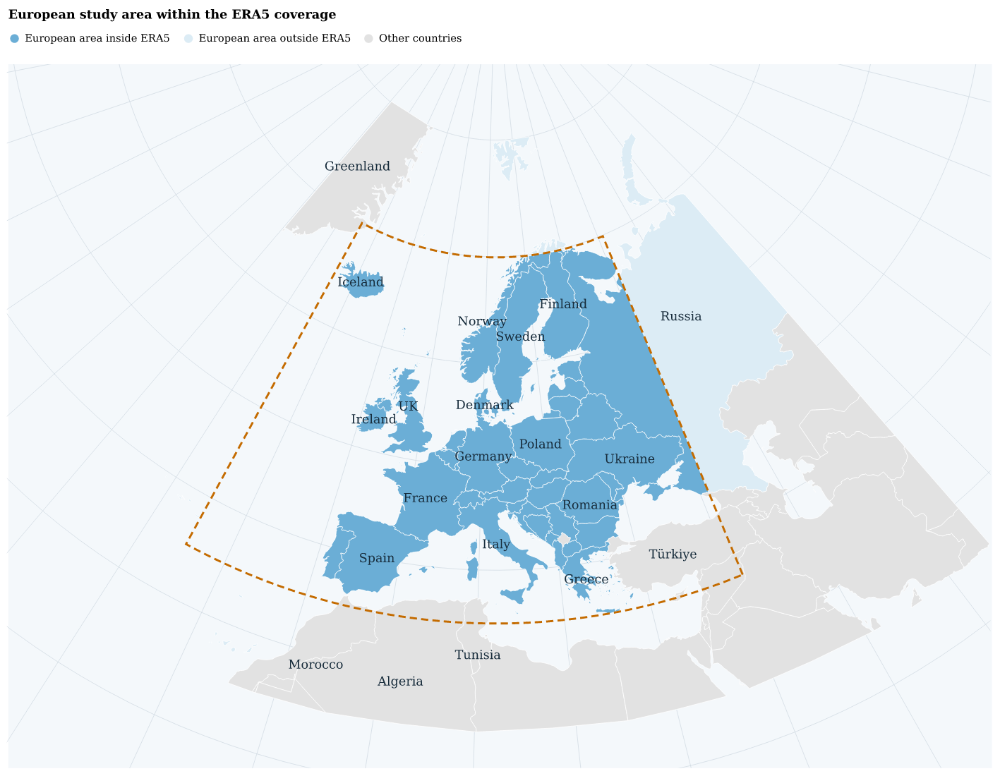

# Data preprocessing

Select European ECA&D daily maximum temperatures for comparison with ERA5-Land over **1 January 2020–31 August 2025**. Residual = station maximum minus ERA5-Land hourly-sampled maximum, in °C. The steps below select observations, resolve their time intervals, match grid cells and calculate temperature pairs.

**Current saved stage, 18 November 2026:** all **68 monthly files** are complete. They contain **9,837,164 observations**, including **8,712,539 matched maxima**. The stricter source-day export is implemented; its output file has not yet been written.

Run the script pipeline from the repository root with [`./run.sh`](../run.sh). It starts a dedicated tmux session, logs to `data2/preprocessing.log`, and writes `running`, then the exit code, to `data2/preprocessing.status`; `0` means success. The session ends with the command.

| Order | Python entry point | Output under `data2/` |
|:---|:---|:---|
| 1, if the cache is absent | `py.scripts.build_station_cache` | `station_data.parquet` |
| 2 | `py.scripts.select_station_observations` | `selected_station_observations.parquet` |
| 3 | `py.scripts.match_era5_grid` | `selected_station_era5_grid.parquet` |
| 4 | `py.scripts.build_monthly_era5_pairs` | `station_era5_monthly/YYYY-MM.parquet` |
| 5 | `py.scripts.export_clean_station_sample` | `station_era5_clean.parquet` |

The runner reuses the raw cache and rebuilds downstream outputs. The ERA5 download, ECA&D source metadata and reviewed observation-window rules must already be available. Each stage saves counts and provenance under `data2/cleaning_audit/`; the selection script also saves spike and range exclusions.

## Inputs

| Dataset | Contents and units |
|:---|:---|
| ECA&D blended station series | Reported temperature maxima: `TX` in tenths of °C, date `DATE` (`YYYYMMDD`), station-series ID `STAID`, observation-source ID `SOUID`, quality flag `Q_TX`. Cached in `data2/station_data.parquet`. |
| ERA5-Land | Hourly 2 m air temperature (`t2m`, Kelvin) on a 0.1° grid, January 2020–August 2025. The downloaded hourly axes define the geographic footprint; their timestamps define the study period. |

## 1. Station quality

Keep daily observations with `Q_TX == 0` and `TX != -9999`: provider-valid records with a reported temperature.

## 2. Geographic selection

Keep observation sources in [UN M49 Europe](https://unstats.un.org/unsd/methodology/m49/overview/) and inside the ERA5 extract: **34.95–69.95°N, 25.05°W–40.95°E**, including the outer half-cell margins. Iceland and the Nordic countries are included; Türkiye, Cyprus and Greenland are excluded. The eligible ISO country and territory codes are:

```text
AL AD AT AX BY BE BA BG HR CZ DK EE FO FI FR DE GI GR GG VA HU IS IE IM
IT JE LV LI LT LU MT MD MC ME NL MK NO PL PT RO RU UA SM RS SK SI ES SJ SE
CH GB
```

Use the source's country and coordinates: blended station series can borrow observations from other locations. Join source metadata on `(STAID, SOUID)`, accounting for the +100000 participant metadata-ID offset; synoptic IDs match directly.



Blue: eligible European land. Pale blue: European land outside the extract. Gray: other countries. Orange dashed line: ERA5 boundary. Country outlines: Natural Earth, 1:50 million. [SVG](assets/geographic_selection.svg) · [PDF](assets/geographic_selection.pdf).

## 3. Isolated spikes and dips

Exclude a daily maximum **at least 25°C above both adjacent days, or at least 25°C below both**, following the spike-check convention cited in [Durre et al. (2010)](https://www.ncei.noaa.gov/pub/data/ghcn/daily/papers/durre-menne-etal2010.pdf).

Compare consecutive calendar days within the same `SOUID`; both neighbours must be present. Count borrowed observations once when calculating flags, then remove every copy of each flagged source-day. Calculate flags once, before the range and study-period filters. This removes **46 source-days, represented by 69 records**, while retaining the other days.

## 4. Temperature bounds

Keep maxima from **−60°C to 50°C, inclusive**. These provisional bounds remove another **323 records**: one below −60°C and 322 above 50°C. Original values remain unchanged in the raw archive.

## 5. Study period

Keep labelled observation dates from **1 January 2020 to 31 August 2025**, matching the hourly ERA5 download.

| Stage, in execution order | Daily records retained |
|:---|---:|
| Raw archive: 8,568 station series | 175,615,474 |
| Provider-valid observations | 133,209,364 |
| European sources | 127,711,784 |
| European sources inside ERA5 | 113,368,058 |
| After spike removal | 113,367,989 |
| After temperature bounds | 113,367,666 |
| Within the study period | **9,840,278** |

Stages before the date restriction use the full historical archive. The study-period selection contains **5,613 station-series IDs and 4,984 observation-source IDs**. Borrowed source observations can still appear in multiple station series.

## 6. Observation windows in UTC

Use each source's observation-window code (`ELEI` in `sources.txt`), country and provider. Resolve the clock, time zone and labelled date from provider definitions and checks against original observations, within each verified source/date scope. ECA&D's existing date shifts are already included in `DATE`.

Intervals include UTC calendar days, previous-day 18:00 → labelled-day 18:00, morning-to-morning windows and `TX7`'s **06:00–18:00 UTC** interval. Danish local calendar days use `Europe/Copenhagen`, spanning **23 or 25 hours** at DST transitions. Verified Luxembourg days use fixed CET (UTC+1). GSOD hourly-fallback maxima cover a UTC reporting day but retain a separate sampling flag: their exact sample times and completeness remain unknown. Detailed provider assignments and evidence are in [Observation windows](OBSERVATION_WINDOWS.md).

Save `window_start_utc`, `window_end_utc`, `window_hours`, `window_rule_id`, `window_status` and `window_sampling`. Unsupported boundaries remain null; every study-period observation is retained.

- **9,651,857 records (98.09%)** have UTC bounds, including **34,965 GSOD sampled reporting days**, explicitly labelled by `window_sampling`.
- **188,421 records (1.91%)** remain unresolved. See the [unresolved-source audit](../data2/cleaning_audit/preprocessing_unresolved_windows.csv) and [coverage table](../data2/cleaning_audit/preprocessing_window_coverage.csv).

## 7. Saved selection

[selected_station_observations.parquet](../data2/selected_station_observations.parquet) contains all **9,840,278 observations**, their raw fields, `station_celsius = TX / 10`, source coordinates, country/provider metadata and UTC-window fields. Zstandard compression: **36.6 MiB**. The [manifest](../data2/cleaning_audit/selected_station_observations.json) records counts and source hashes.

This selection precedes the geographical lookup and monthly ERA5 extraction below. The selected input retains observations whose windows extend outside the download; the monthly extraction drops them.

## 8. Geographical ERA5 lookup

Run `py.scripts.match_era5_grid` to match the **4,775 distinct source coordinate pairs** to the nearest coordinate on each actual hourly ERA5-Land grid axis. Exact ties use the larger coordinate. All **68 monthly files** have identical axes and array ordering. Masked cells remain at their nearest grid position; no land fallback is applied.

[selected_station_era5_grid.parquet](../data2/selected_station_era5_grid.parquet) has **7,413 rows**, one per `(STAID, SOUID, source_lat, source_lon)`, and joins to all **9,840,278 observations**. It contains the join keys, observation count, first/last labelled dates, `latitude_index`, `longitude_index`, `grid_cell_id`, `era5_lat`, `era5_lon`, `era5_cell_masked` and `grid_match_status`.

Indices are zero-based positions in the downloaded arrays. Latitude is descending; longitude is ascending. `grid_cell_id = latitude_index * 660 + longitude_index` identifies a cell on this specific grid.

| Match status | Distinct source coordinates | Station/source locations | Observations |
|:---|---:|---:|---:|
| Available cell | 4,346 | 6,782 | 8,880,929 |
| Masked cell | 429 | 631 | 959,349 |
| Outside grid footprint | 0 | 0 | 0 |

The available locations use **3,690 distinct grid cells**. The mask flag records non-finite temperature at the first downloaded hour; extraction must also respect the hourly completeness audit. This step saves spatial matches only, preserving all observations and their window metadata. The [lookup manifest](../data2/cleaning_audit/selected_station_era5_grid.json) records hashes, grid identity, matching rules and the saved-lookup join check.

## 9. Monthly observations with ERA5 maxima

`py.scripts.build_monthly_era5_pairs` has saved **68 files**, [2020-01.parquet through 2025-08.parquet](../data2/station_era5_monthly/). Each observation belongs to its ECA&D `DATE` month, even when its UTC interval crosses a month boundary. The script reads monthly ERA5 arrays in storage-aligned blocks, caches neighbouring months and computes maxima in NumPy batches.

Use **both endpoints**: `window_start_utc <= valid_time <= window_end_utc`. ERA5-Land `2m_temperature` is instantaneous at its UTC timestamp, with **no one-hour shift**. A 24-hour window therefore contains **25 samples**; 12-, 23- and 25-hour windows contain 13, 24 and 26 samples. Adjacent windows can share their boundary sample.

Drop observations if the start is before **2020-01-01 00:00 UTC** or the end is after **2025-08-31 23:00 UTC**. Record their input row IDs and boundaries in [station_era5_monthly_dropped.csv](../data2/cleaning_audit/station_era5_monthly_dropped.csv). In particular, a window ending at 2025-09-01 00:00 requires a sample outside this download.

Preserve the original station columns and UTC-window metadata, including `window_sampling`, and add the geographical lookup and:

| Column | Meaning |
|:---|:---|
| `observation_id` | Zero-based row position in the input Parquet identified by the manifest hash. |
| `era5_tmax_celsius` | Maximum of all required hourly samples, converted from Kelvin to °C; null unless every sample is finite. |
| `era5_expected_samples`, `era5_available_samples` | Required and finite sample counts. |
| `era5_window_closure` | `both`. |
| `era5_match_status` | `matched`, `unknown_window`, `masked_cell`, `outside_grid` or `incomplete_era5_hours`. |
| `residual_celsius` | Station maximum minus ERA5 hourly-sampled maximum, in °C. |

Unknown windows and unavailable temperatures remain as rows with null ERA5 maxima and explicit status. A matched GSOD sampled reporting day retains its sampling flag; its original sample times need not coincide with every ERA5 hour. No ERA5-based temperature filtering, interpolation or land fallback is applied.

| Extraction outcome | Observations |
|:---|---:|
| Matched maximum | **8,712,539** |
| Unknown UTC window; retained with null maximum | 188,421 |
| Masked grid cell; retained with null maximum | 936,204 |
| Outside grid / incomplete ERA5 hours | 0 |
| Total saved across 68 monthly files | **9,837,164** |
| Dropped: window extends outside the download | 3,114 |
| Selected input | **9,840,278** |

The status counts assign unknown windows before checking the grid mask; they therefore differ from the geographical lookup's mask counts. **25,696 matched records** are GSOD sampled reporting days.

The [monthly coverage table](../data2/cleaning_audit/station_era5_monthly_coverage.csv) records counts and output hashes. The [manifest](../data2/cleaning_audit/station_era5_monthly.json) records input, source and code hashes, endpoint rules, dropped counts and completion status. All 68 saved file hashes match the coverage table.

## 10. Stricter source-day sample

`py.scripts.export_clean_station_sample` is ready to write `data2/station_era5_clean.parquet` from the completed monthly files. It verifies their listed hashes, then applies two filters:

```python
(era5_match_status == "matched") & (window_sampling == "provider_daily_maximum")
```

Keep one row per `(SOUID, DATE)`, choosing the smallest input `observation_id`. Reject conflicting station or ERA5 temperatures, source coordinates, grid cells or UTC boundaries before deduplicating.

| Selection from the saved monthly files | Records |
|:---|---:|
| Complete provider daily maxima | 8,686,843 |
| Repeated blended records removed | 1,960,630 |
| Unique source-days | **6,726,213** |

There are **no conflicting source-days**. All resolved durations are retained, including **12-hour windows** and 23/25-hour daylight-saving days. GSOD sampled reporting days are excluded by the sampling filter.

These counts have been checked against the saved monthly data. **The stricter Parquet and its manifest have not yet been written.** When run, the export saves its counts and input hashes to `data2/cleaning_audit/station_era5_clean.json`. The earlier screened release remains at `data2/clean/analysis.parquet`.

Load the clean sample into a Polars DataFrame:

```python
import polars as pl

from py.paths import AnalysisDataDirectory as data_dir

clean_sample = (
    pl.scan_parquet(data_dir / "station_era5_monthly/*.parquet")
    .filter(
        (pl.col("era5_match_status") == "matched")
        & (pl.col("window_sampling") == "provider_daily_maximum")
    )
    .sort("observation_id")
    .unique(subset=["SOUID", "DATE"], keep="first", maintain_order=True)
    .collect()
)
```
